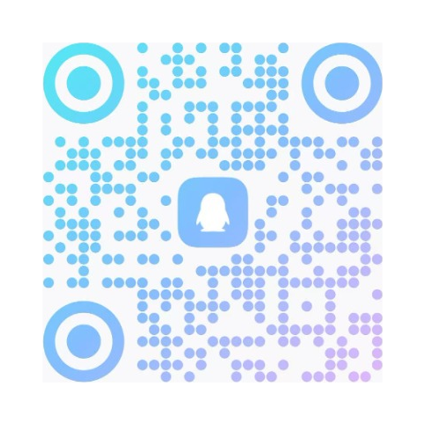
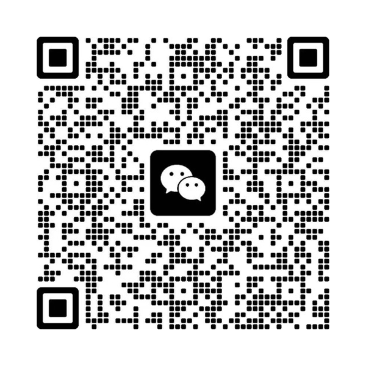

English | [简体中文](README.md)

# Antigravity Multi-Language Dictionary

[](LICENSE)
[](dist/zh-cn-ui-dictionary.json)
[](locales/)
[](https://antigravity.google)

Clean multi-language dictionary datasets for Google Antigravity.

---

## 1. Overview

Localization datasets verified through four safety audit gates:
1. **Multi-Language Coverage**:
   - Simplified Chinese (zh-CN): 23,284 terms (62 micro-slices);
   - Traditional Chinese (zh-TW): 23,284 terms (62 micro-slices);
   - Japanese (ja-JP): 170 terms (7 slices);
   - English Baseline (en-US): Official metadata;
2. **Four Safety Gates**:
   - Placeholders: Preserves `${command}` and `{0}`;
   - Anti-Recursion: Prevents infinite DOM recursion;
   - Brand Preservation: Keeps `Antigravity` in original English;
   - Code & Path Immunity: Extensions (`.js`, `.py`, `.md`) and paths remain 100% untouched.

---

## 2. Directory Structure

```
Antigravity-Chinese-Dictionary/
├── locales/                     # Decoupled packages (zh-CN, zh-TW, ja-JP, en-US)
│   ├── zh-CN/                   # Simplified Chinese (62 micro-slices, 23,284 terms)
│   ├── zh-TW/                   # Traditional Chinese (62 micro-slices, 23,284 terms)
│   ├── ja-JP/                   # Japanese (7 slices, 170 terms)
│   └── en-US/                   # English baseline metadata
├── dicts/                       # Compatibility slices (Simplified Chinese, 62 slices)
├── dicts_tw/                    # Compatibility slices (Traditional Chinese, 62 slices)
├── dicts_ja/                    # Compatibility slices (Japanese, 7 slices)
├── dist/                        # Aggregated JSON dictionaries
│   ├── zh-cn-ui-dictionary.json # Simplified Chinese (23,284 terms)
│   ├── zh-tw-ui-dictionary.json # Traditional Chinese (23,284 terms)
│   └── ja-jp-ui-dictionary.json # Japanese (170 terms)
├── build-dictionary.js          # Package builder & audit pipeline
├── LICENSE                      # MIT License
└── README_EN.md                 # English documentation
```

---

## 3. Usage & Build

### 3.1 Direct JSON Loading
Load JSON from `dist/` or `locales/<lang>/dictionary.json` directly.

### 3.2 Developer Build & Safety Audit Hub (build-dictionary.js)

`build-dictionary.js` serves as the automated assembly pipeline and four-fold crash-prevention gatekeeper for the entire dictionary repository. It is implemented purely with Node.js standard libraries, requiring zero external npm dependencies.

**Core Responsibilities**:
1. **Automated Micro-Slice Assembly**: Recursively reads micro-slice files (e.g., 62 slices for zh-CN), merges them with deduplication, outputs standalone production dictionaries (`dist/*.json` & `locales/<lang>/dictionary.json`), and synchronizes compatibility directories (`dicts/`, `dicts_tw/`, `dicts_ja/`);
2. **Four Zero-Crash Safety Gates**: Audits every term before compilation. Any violation triggers immediate build failure (exit code 1):
   - **Placeholder Preservation**: Validates `${command}` and `{0}` tokens to prevent authorization deadloops;
   - **Anti-Recursion Protection**: Blocks translations containing original English keys (e.g., `Save` -> `Save 保存`) to prevent infinite DOM replacement loops;
   - **Brand Preservation**: Prevents translating `Antigravity` or `Google` into improper localized terms;
   - **Code & Path Immunity**: Protects source code extensions (`.js`, `.py`, `.json`, `.md`) and system filenames (`package.json`) from unintended translation;
3. **Manifest & SHA-256 Generation**: Computes total deduplicated terms, file sizes (KB), and SHA-256 integrity checksums into `locales/<lang>/manifest.json` for client-side update verification.

#### Developer Build Commands

Developers contributing new terms or submitting Pull Requests **must execute this pipeline and ensure an exit code of 0**:

```bash
# Build and verify all language packages (recommended before PR)
node build-dictionary.js all

# Build and verify Simplified Chinese (zh-CN) only
node build-dictionary.js --locale zh-CN

# Build Traditional Chinese or Japanese only
node build-dictionary.js --locale zh-TW
node build-dictionary.js --locale ja-JP
```

> **Acceptance Criteria**: The terminal must report `安全审计错误: 0 项` and exit with `0`.

---

## 4. Community & Disclaimer

| QQ Group (222403941) | WeChat Community |
| :---: | :---: |
|  |  |

1. **Research Purpose**: For software localization research;
2. **As-Is Basis**: Provided under MIT License;
3. **Trademark Notice**: Google and Antigravity are trademarks of Google LLC;
4. **Non-Commercial**: Reselling or repackaging is strictly prohibited.
